<div align="center">

# VAYU-SARTHI

**Dynamic air operations and resource optimisation: a decision engine with a dashboard on top**

Smart India Hackathon 2026 · Problem Statement **26250** (Air Power) · Ministry of Defence / Defence Services Staff College

Team **NexaBuild**

**[Live demo: vayu-sarthi.onrender.com](https://vayu-sarthi.onrender.com/)** ·
[Demo video (narrated, 6½ min)](docs/media/VAYU-SARTHI_demo.mp4) ·
[Idea deck (PDF)](docs/NexaBuild_VAYU-SARTHI_SIH2026.pdf) ·
[Design and roadmap](docs/PLAN.md)


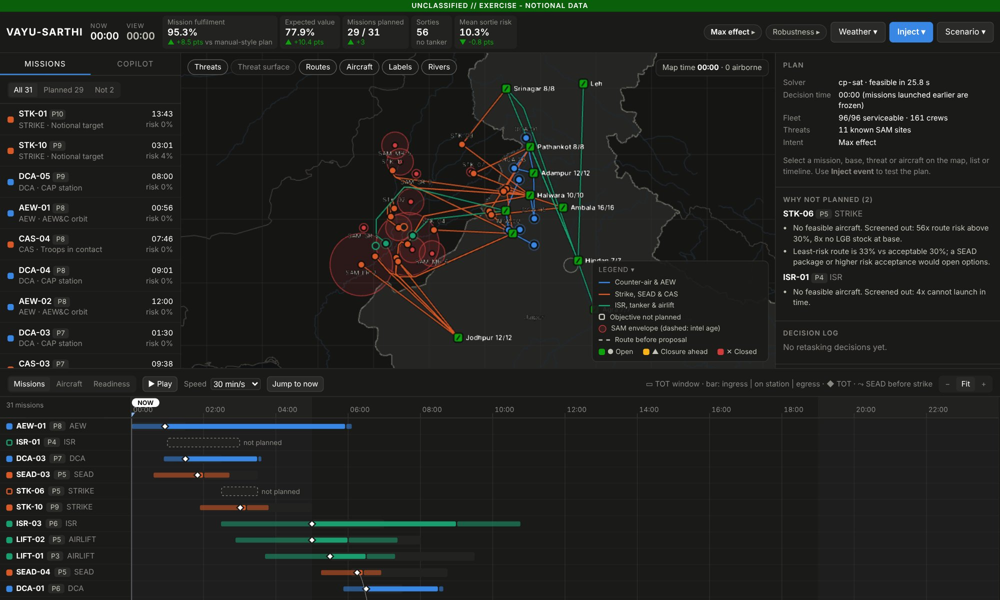

</div>

> *Sarthi* means charioteer. Arjuna fights; the charioteer reads the battlefield, sees the options and advises.
> VAYU-SARTHI is the air planner's charioteer: it fuses the picture, predicts what is about to break, computes the
> best re-plan in seconds and explains it. **The commander decides.**

### Watch the demo

[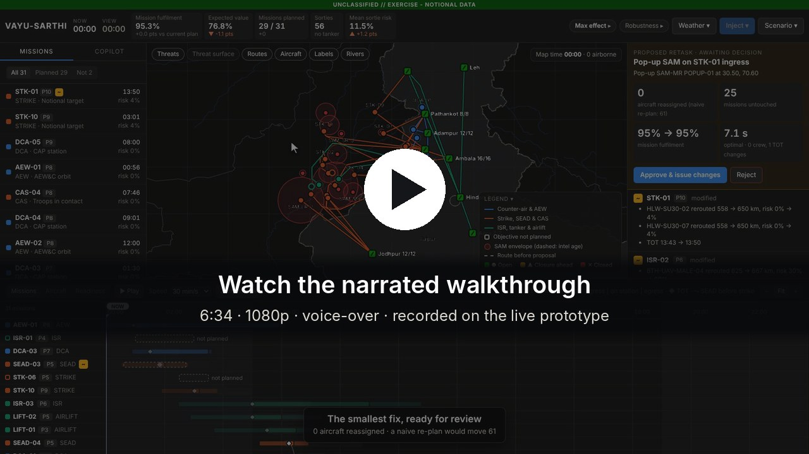](docs/media/VAYU-SARTHI_demo.mp4)

A narrated walkthrough of the live prototype: the day's plan, why missions are not planned, a pop-up SAM retask, the
copilot, courses of action, robustness, readiness, fog closures, then flood and earthquake relief. Recorded on the free
cloud server with the solver's waiting time cut; the MP4 includes English subtitles.

---

## Contents

1. [The problem](#the-problem)
2. [What VAYU-SARTHI does](#what-vayu-sarthi-does)
3. [Results](#results)
4. [A tour of the prototype](#a-tour-of-the-prototype)
5. [How it works](#how-it-works)
6. [Tech stack](#tech-stack)
7. [Run it](#run-it)
8. [Engine, API and tests](#engine-api-and-tests)
9. [Repository layout](#repository-layout)
10. [Data, honesty and limits](#data-honesty-and-limits)
11. [Roadmap](#roadmap)
12. [Documents](#documents)

---

## The problem

An air tasking order (ATO) assigns every sortie of the day: the mission, aircraft, base, time on target (TOT),
weapons, tanker and crew. Building one means cross-checking seven systems that do not talk to each other:

| Input named in the problem statement | What it constrains |
|---|---|
| Aircraft availability | Which tails can fly, and when (serviceability, turnaround) |
| Crew status | Type qualification, night currency, fatigue, duty limits, rest |
| Weapon loads | Stocks per base, carriage per aircraft type |
| Airspace | Restricted and civil airspace the routes must avoid |
| Weather | When a base can launch and recover aircraft |
| Threats | Route risk, and which missions need suppression (SEAD) first |
| Mission priorities | What to keep when not everything can be flown |

The hard part is **retasking**. One event ripples through all seven: a base fogs in, its sorties move to another
base, which changes routes, fuel, tanker needs, crew duty, that base's weapons and its alert reserve. A planner can
do this once by hand. Doing it five times an hour **while keeping the rest of the plan stable** (crews are briefed,
weapons are loaded) is where hours are lost and mistakes are made.

## What VAYU-SARTHI does

It closes the loop from data to decision in seconds, and the human stays in charge of every change.

```
 OBSERVE               ORIENT                       DECIDE                          ACT
 data feeds   ->  one fused world state  ->  predictive layer   ->  optimiser + explainer  ->  commander approves
 (maintenance,    (single source of truth,   (fog, serviceability,  (plan, minimal retask,     -> change orders
  crews, weapons,  freshness per feed)        crew fatigue,          3 courses of action,      -> audit log
  met, intel,                                 threat age)            reasons for everything)
  airspace)
     ^                                                                                              |
     +---------------------------------- events from execution -----------------------------------+
```

Four ideas set it apart from a dashboard with some ML attached:

1. **Minimal-disruption retasking.** When something changes, it does not regenerate the plan. It finds the *smallest
   set of changes* that recovers the most mission value and shows it as a reviewable diff. Changes cost more the
   closer a mission is to launch; launched missions are frozen.
2. **One integrated model.** Aircraft, crews, fatigue, weapons, tankers, weather, threats, airspace and alert
   reserves sit in a single CP-SAT optimisation, so cascades are handled automatically: a pop-up SAM forces a
   reroute, the longer route needs a tanker, and the tanker comes off a lower-priority package.
3. **Explainable by construction.** Every unplanned mission and every change carries a reason, and the engine can
   say *what it would take* to get a mission flown, with the cost of each option.
4. **Predict, then act early.** A fog model trained on real airfield observations turns forecasts into proposed
   base closures before the fog arrives.

The same engine, unchanged, also plans **disaster relief (HADR)**: a flood in Assam and Bihar and an earthquake in
the Garhwal Himalaya.

## Results

All numbers are measured by the benchmark scripts in this repo on a laptop-class CPU, against a greedy "manual
planner" baseline that obeys the same constraints. Every plan passes an independent constraint checker
(`validate.py`).

| Planning (20 random scenarios, 33–39 missions, 96 aircraft, ~160 crews) | Greedy planner | VAYU-SARTHI |
|---|---|---|
| Priority-weighted mission fulfilment | 85.1% | **97.5%** |
| Expected mission value (serviceability, tankers, SEAD before strike, losses) | 65.3% | **78.8%** |
| Plan time | milliseconds (worse plan) | 4–10 s |

| Retasking: busiest base fogged 05:00–09:30, known at 02:00 (8 scenarios) | Re-plan from scratch | VAYU-SARTHI |
|---|---|---|
| Aircraft reassigned (of ~70 sorties) | 49.5 | **14.5 (−71%)** |
| Solve time | similar | **2.8 s** |
| Fulfilment after the event | n/a | 95.6% (from 96.5%) |

| Disaster relief (20 scenarios each) | Greedy planner | VAYU-SARTHI |
|---|---|---|
| Flood: relief tonnage planned of requested | 81.6% | **94.5%** |
| Earthquake: relief tonnage planned of requested | 81.0% | **88.1%** |

| Other components | Result |
|---|---|
| Fog forecast, held-out winter 2025–26 (9,427 hours) | Brier skill **+44%** vs climatology, AUC **0.91**; detects 70% of fog hours vs 26% from raw forecast visibility |
| Ground spares (8 scenarios) | Bad-day (p05) mission success 66.9% → **69.9%** with **zero** flying changes |
| Three courses of action | Solved in parallel in **~6 s** |
| Copilot routing (20 paraphrased questions) | Parser alone 14/20; parser + small local model **20/20** |

---

## A tour of the prototype

Everything below is the real application, captured from the [live deployment](https://vayu-sarthi.onrender.com/).
All scenario data is notional and randomly generated from a seed.

### 1. Common operational picture and synchronisation matrix

The main screen, shown at the top of this page, has five parts:

- **Top bar:** KPI tiles (mission fulfilment and expected value, each compared with a manual-style plan; missions
  planned; sorties; mean sortie risk), the *Inject event* menu, the scenario menu, the commander's-intent chip and the
  robustness chip.
- **Map (centre):** an offline basemap with India's boundary as officially depicted. Bases are coloured by status
  (open, closure ahead, closed). SAM envelopes are shaded by lethality, and a dashed halo shows where a *mobile* SAM
  may have moved since it was last seen. Routes are coloured by mission family, tankers fly their tracks, and
  aircraft move along their routes as the clock runs.
- **Synchronisation matrix (bottom):** every mission's TOT window, package bar (ingress, on station, egress), SEAD →
  strike sequencing arrows and tanker support. Switch to the *Aircraft* view for lanes per tail, grouped by base.
  The NOW line freezes launched missions; drag the cursor or press Play to watch the day unfold.
- **Mission list (left):** missions by priority with their TOT and route risk; the *Copilot* tab sits beside it.
- **Side panel (right):** the plan summary (solver, fleet, threats, intent) and **why each unplanned mission is not
  planned**, e.g. *"Least-risk route is 33% vs acceptable 30%; a SEAD package or higher risk acceptance would open
  options."* It becomes the proposal review when something changes.

### 2. Mission card

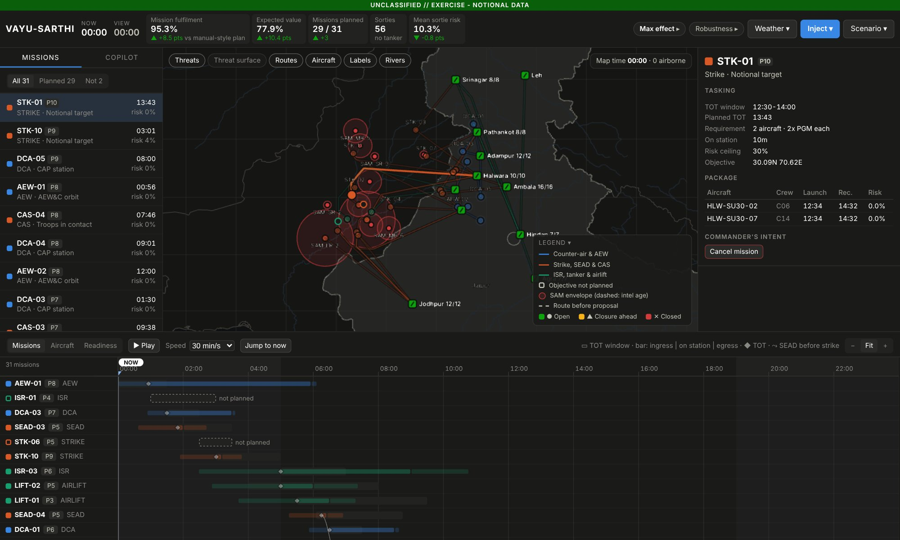

Click any mission, base, threat or aircraft (on the map, the list or the timeline) for its card. A mission card shows
the tasking (TOT window, planned TOT, aircraft and weapons required, risk ceiling) and the package: each aircraft, its
crew, launch and recovery times and route risk. The selected route is highlighted on the map. Cards carry what-if
actions (raise priority, cancel a mission, close a base, ground an aircraft); each becomes a proposal, and nothing
changes until it is approved.

### 3. Retasking with a human in the loop

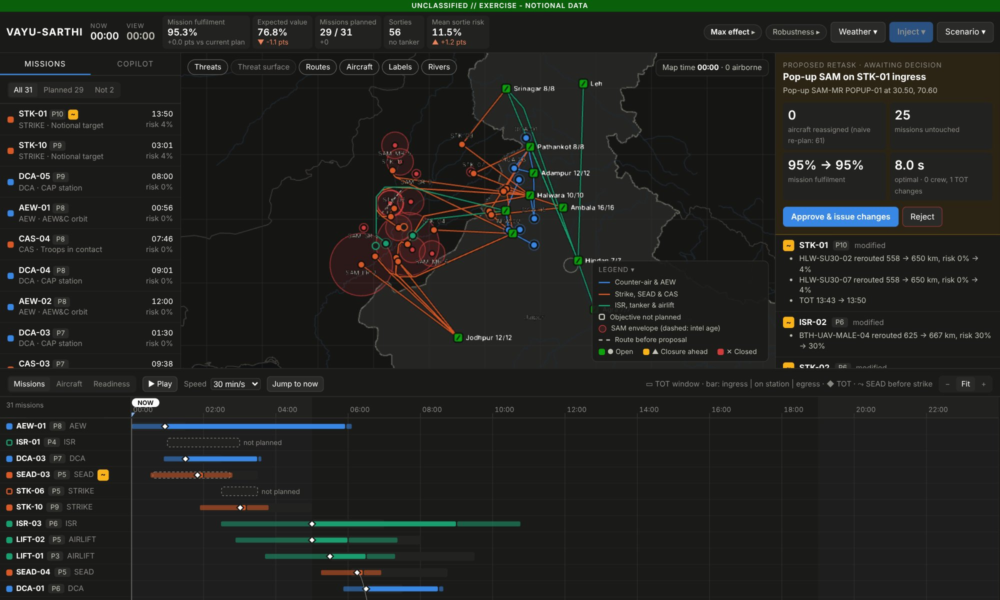

*Inject event* offers presets built from the current plan (a pop-up SAM on a strike's ingress, a fog forecast, a
maintenance alert, a time-sensitive target, a cratered runway, an ammunition point hit) and map tools (drop a SAM
anywhere). The engine returns a **proposal**:

- a per-mission diff: added, dropped (with the reason), modified (tails in and out, crew changes, TOT shifts,
  reroutes);
- *"a naive re-plan would change N aircraft"*, next to how many this one changes;
- KPI deltas against the current plan;
- old routes drawn as dashed ghosts on the map, new sorties outlined on the timeline.

**Approve & issue** or **Reject**. Every decision is logged.

Above, a pop-up SAM appears on STK-01's ingress. The engine reroutes the two strike aircraft around it (558 → 650 km;
route risk 0% → 4%, well under the 30% ceiling), shifts the TOT by 7 minutes and adjusts the missions that shared
that airspace, **reassigning 0 aircraft** where a re-plan from scratch would have moved 61. Mission fulfilment stays
at 95%.

### 4. Why not? What would it take?

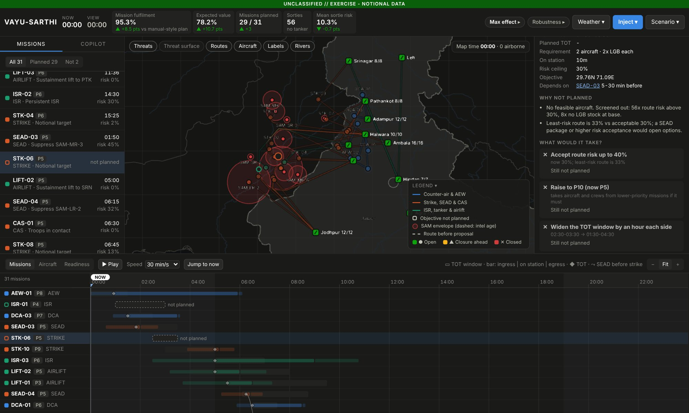

An unplanned mission's card explains why, for example *"Least-risk route is 33% vs acceptable 30%; a SEAD package
would open options."* **Find what gets it planned** tries single relaxations in parallel (accept more route risk,
raise to P10, widen the TOT window, resupply weapons), re-solves each as a minimal retask, and shows the cost of
each: aircraft changed, missions dropped, fulfilment before and after, with a **Propose** button.

On a laptop, the first option for STK-06 works: *accept route risk up to 40% (now 30%; least-risk route 33%) →
planned, 2 aircraft changed, nothing dropped, fulfilment 95.3% → 97.9%*, while raising it to P10 or widening its window
would not help. The screenshot is from the free 0.1-CPU server, which gives each re-solve far less compute; there none
of the three gets it planned in time, and the card says so rather than guessing.

### 5. Copilot

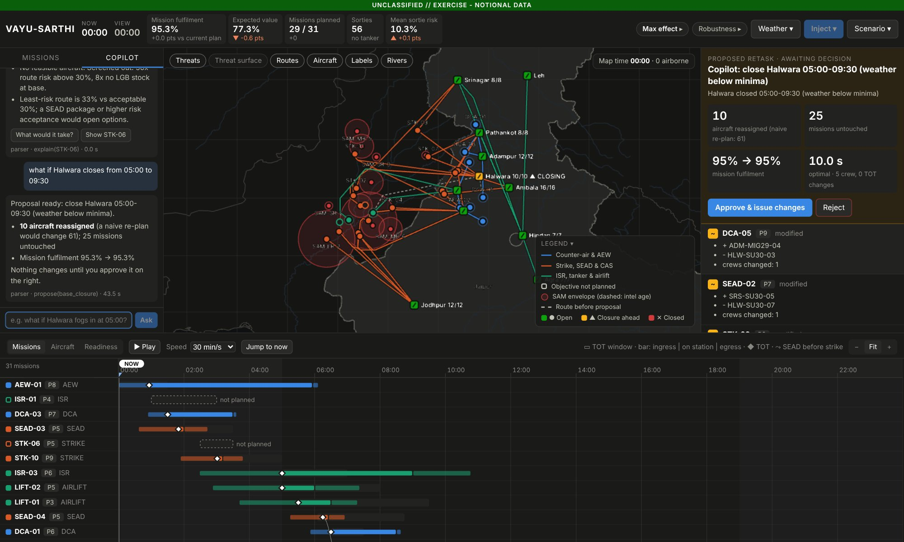

Press `/` and ask in plain language: *why isn't STK-06 planned?*, *can we squeeze it in?*, *what if Halwara fogs in
between 0500 and 0930?*, *how robust is the plan?*, *readiness at Jodhpur*.

The copilot **never invents an answer**. It only picks which of 18 engine tools to run; the reply is a template filled
by the engine, so every number comes from the solver. Each answer shows how it was routed and which tool produced it
(above: `parser · explain(STK-06)`), with follow-up buttons such as *What would it take?* and *Show STK-06*.

What-if questions come back as a normal proposal for approval. Above, *"what if Halwara closes from 05:00 to 09:30"*
becomes a closure proposal on the right: 10 aircraft reassigned where a naive re-plan would change 61, 25 missions
untouched, fulfilment unchanged at 95.3%. See [Copilot: grounded by design](#copilot-grounded-by-design) for how
routing works.

### 6. Courses of action

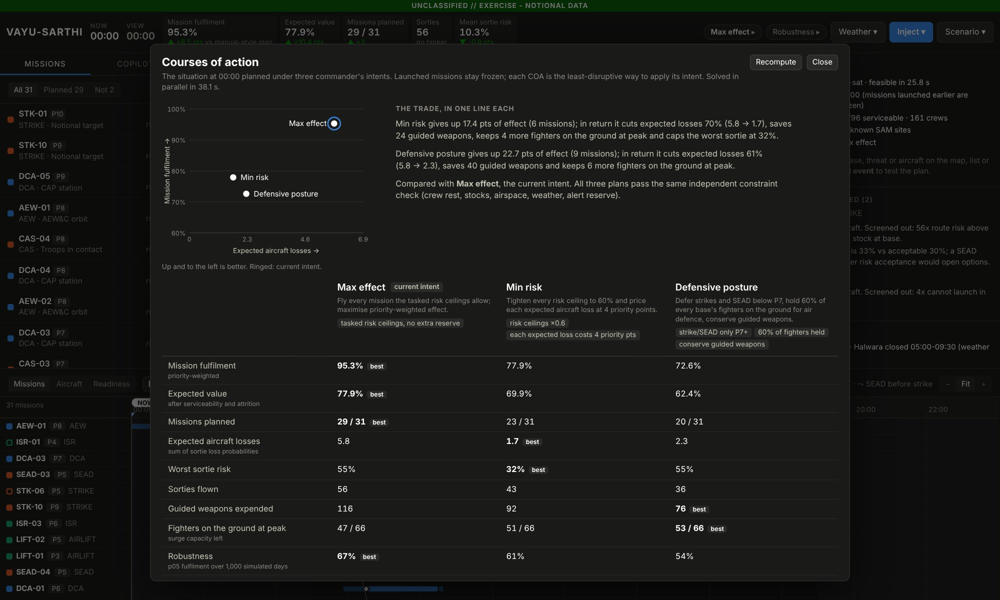

The intent chip opens the same situation planned under three commander's intents, solved in parallel:

| Intent | What it changes |
|---|---|
| **Max effect** | Fly everything the tasked risk ceilings allow |
| **Min risk** | Every risk ceiling × 0.6, and each expected aircraft loss is priced into the objective |
| **Defensive posture** | Defer strike and SEAD below P7, keep ≥ 60% of each base's fighters on air-defence alert, price guided weapons |

A scatter plots fulfilment against expected losses, one computed sentence states each trade (*"Min risk gives up 17.4
pts of effect (6 missions); in return it cuts expected losses 70%…"*), and a table compares fulfilment, expected value,
losses, worst sortie risk, sorties, weapons, fighters on the ground and bad-day robustness. **Adopt** turns a COA into
a proposal; once approved, its intent applies to every later retask. (The three solves take about 6 s on a laptop;
the screenshot is from the free 0.1-CPU server, where they take about 40 s.)

### 7. Robustness and ground spares

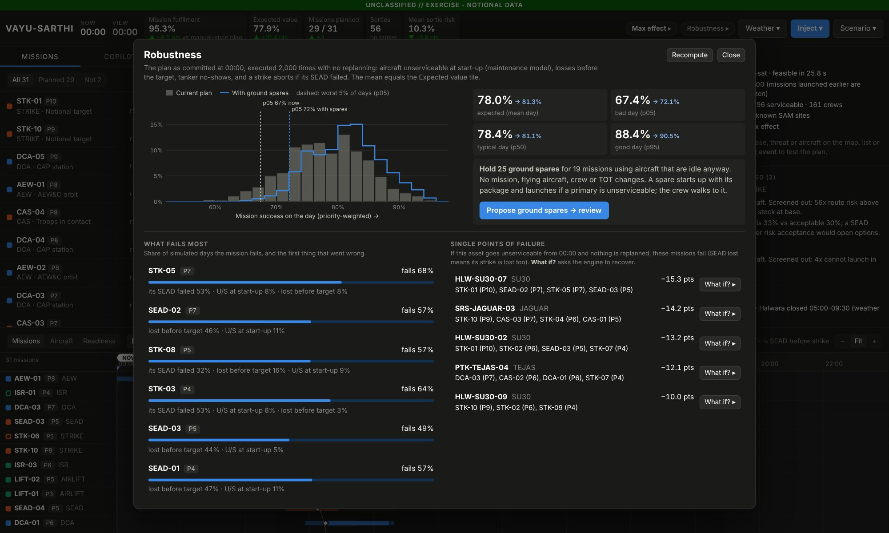

The committed plan is flown through **2,000 simulated days** without replanning: aircraft go unserviceable at start-up
or are lost before the target, tankers fail to turn up, and a strike aborts if its SEAD failed. The panel shows:

- the distribution of mission success (p05 / p50 / p95), current plan vs with ground spares;
- **what fails most**, with the first cause (*"STK-05 fails 68% of days: its SEAD failed 53% · U/S at start-up 8% ·
  lost before target 8%"*);
- **single points of failure**: the assets whose loss costs the most, cascades included, each with a *What if?* that
  becomes a retask proposal;
- **Propose ground spares**: hold idle aircraft as spares where they add the most expected value, with zero changes
  to flying aircraft, crews or times.

Above, holding 25 spares from aircraft that are idle anyway raises the bad day (p05) from 67.4% to 72.1% and the mean
from 78.0% to 81.3%.

### 8. Fog forecast to proposed closures

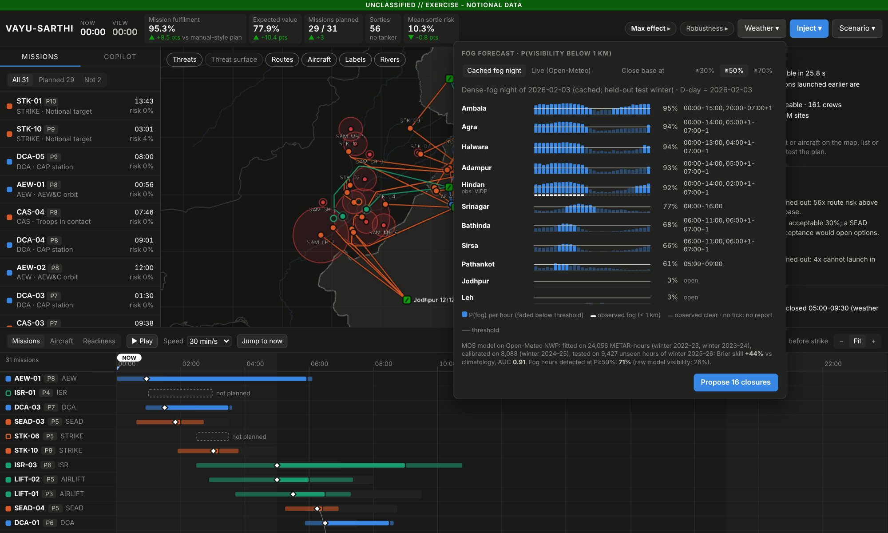

North Indian winter fog closes airfields for hours. The *Weather* panel shows P(visibility < 1 km) for each base and
hour, from a model trained on real METAR observations (section [Fog forecasting](#fog-forecasting)). Choose the source
(a cached real dense-fog night that works offline, or live Open-Meteo) and the risk threshold (≥ 30 / 50 / 70%), then
**Propose closures**. The cached night is 3 February 2026 from the held-out test winter; Hindan's row overlays Delhi's
observed METAR (white ticks are observed fog), which verifies the forecast.

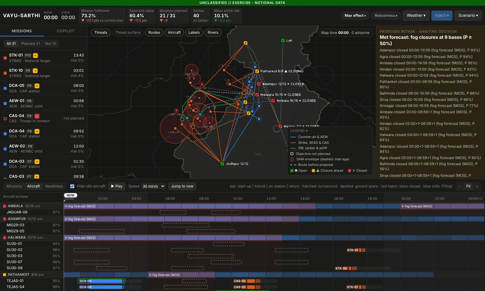

The closures go through the normal proposal flow. That night fogged in most of the north Indian plains, so the
proposal closes 9 bases, five of them until early afternoon, and mission fulfilment falls to 73%; the engine re-plans
what it can from the bases that stay open and lists what cannot be saved. In the *Aircraft* view, closures are hatched red across a
base's lanes, blue cells show P(fog) per hour, old sorties are dashed and new ones are outlined.

### 9. Readiness board

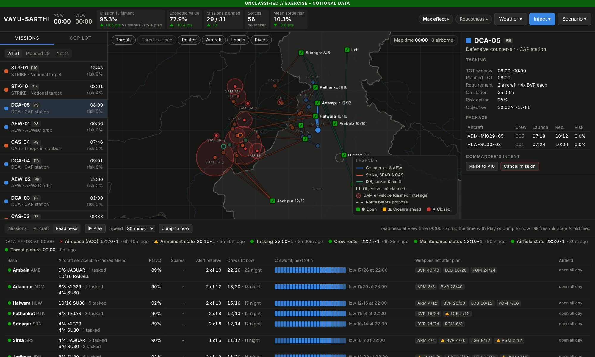

One row per base at the view time: aircraft serviceable and tasked by type, mean P(serviceable), ground spares, alert
reserve, crews fit now plus a 24-hour strip of crews fit per hour (fatigue model and night currency), weapons left after
the plan (▲ when low) and closures. A badge for each data feed says how old it is (● fresh, ▲ stale, ✕ old): above,
the airspace order is 6 h 40 min old and the armament state is stale, so the commander knows which parts of the plan
rest on old data. Events refresh the feed they come from.

### 10. Threat surface

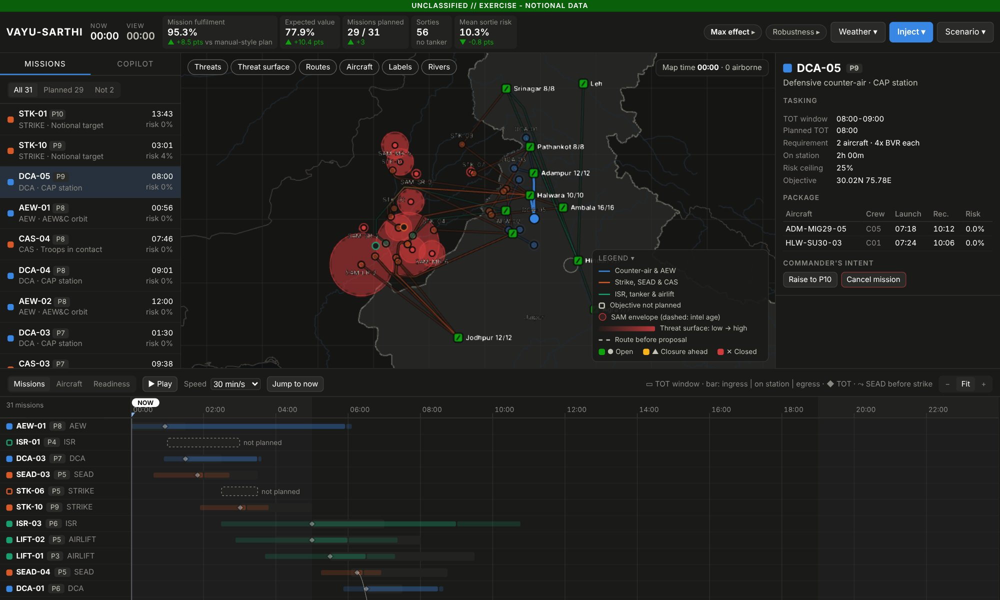

The *Threat surface* layer shows the hazard field the router actually uses. Routes bend around it: risk vs distance is
traded explicitly, and a strike that depends on SEAD is routed through the suppressed envelope.

### 11. Same engine, flood relief

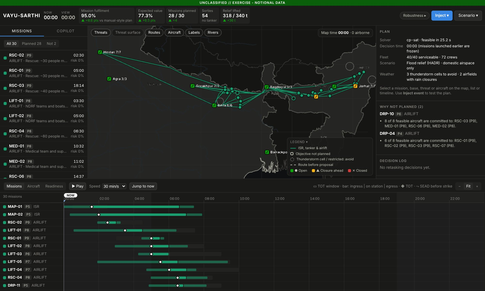

*Scenario ▾ → Flood (HADR)* plans a monsoon flood day in Assam and Bihar. Fixed-wing transports lift NDRF teams and
stores to airfields whose runway length decides which types can land; helicopters fly rescues, medical teams and relief
drops to marooned villages; UAVs map the flood. Flights stay in Indian airspace (through the Siliguri corridor, never
over Bangladesh), and thunderstorm cells are flown around. The last KPI tile becomes *Relief lifted*: above, 318 of
340 t, 36 t more than the manual-style plan. The *why not planned* panel explains competition for helicopters
(*"8 of 8 feasible aircraft are committed to RSC-03 (P9), MED-01 (P8)…"*). Presets: an embankment breach, heavy rain
at the busiest airfield, a storm cell on a route, helicopters unserviceable, a cancelled road convoy.

### 12. Same engine, earthquake relief in the Himalaya

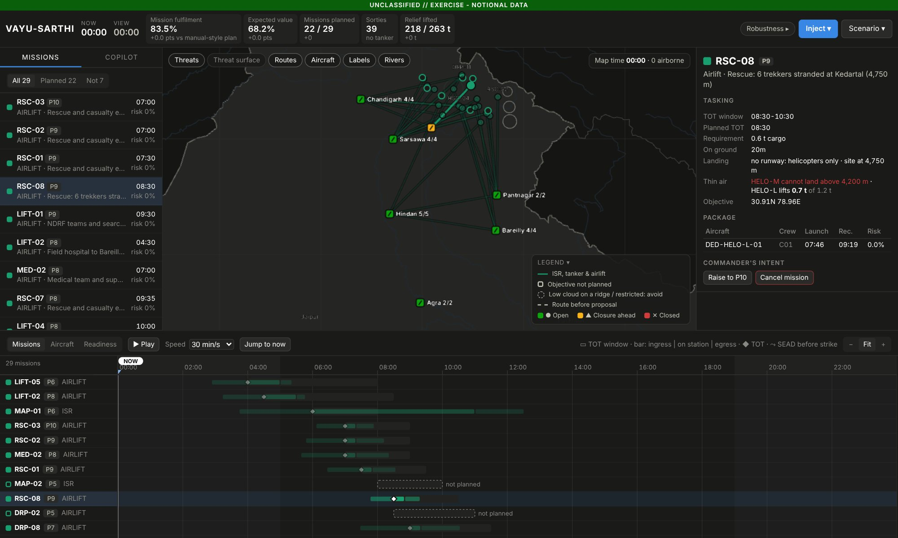

*Scenario ▾ → Earthquake (HADR)* plans a notional M6.8 earthquake in the Garhwal Himalaya. The mountains add three
constraints, each enforced by the screen, the optimiser and the validator:

- **Damaged runways.** Jolly Grant is cracked to 1,500 m usable, so it takes the medium transport but not the heavy
  one. An *aftershock* preset cuts it to 900 m.
- **Thin air.** Helicopter payload falls with landing-site elevation. At Kedarnath (3,580 m) the medium helicopter
  lifts 2.1 t of its 4 t, so a 30-person rescue needs two.
- **Landing ceilings.** Trekkers stranded at Kedartal (4,750 m, the card shown above) are beyond the medium
  helicopter's ceiling. Its **Thin air** row reads *"HELO-M cannot land above 4,200 m · HELO-L lifts 0.7 t of 1.2 t"*,
  so the engine sends a light helicopter from Jolly Grant.

On the free 0.1-CPU server the solver could not beat the greedy plan within its time budget for this scenario, so it
kept the greedy plan (hence *+0.0 pts* in the screenshot); on a laptop the same seed reaches 91.5% fulfilment.

---

## How it works

### Architecture

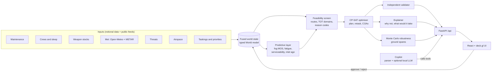

The engine and the UI ship as **one process on one port**. After the first install, nothing needs the internet: the
basemap is bundled GeoJSON, fonts are system fonts, and the fog demo uses a cached real night.

### The planning pipeline

1. **Fused world state** (`models.py`). One typed `World`: bases, aircraft types, tails, crews, threats, airspace
   zones, missions, weapons, closures, commander's intent and data-feed freshness. Times are minutes from 00:00 D-day.
2. **Threat-aware routing** (`threats.py`). A 0.1° grid over the theatre. Each SAM adds a hazard rate inside its
   envelope, so a full crossing costs its Pk; route risk is `1 − exp(−2·∫hazard)`. A mobile SAM's envelope grows with
   the age of the intel and its lethality spreads out. Dijkstra from each target to every base at once (SciPy sparse),
   then string pulling replaces grid zig-zags with straight legs wherever that costs no more risk.
3. **Crew fatigue** (`fatigue.py`). A two-process sleep model (homeostatic + circadian) predicts each crew's
   effectiveness through the day, giving the TOTs at which that crew is fit to fly.
4. **Feasibility screening** (`candidates.py`). For every (mission, aircraft) pair: route, transit, launch and recovery
   times, and the **set of allowed TOTs** (mission window, aircraft availability, base closures, runway length,
   altitude). Every rejection increments a **reason code**, which is what makes "why not?" answerable.
5. **Allocation** (`optimizer.py`). One CP-SAT model:

   ```
   maximise   Σ 1000·priority·flown  +  Σ (pairing quality − sortie cost)  +  crew fitness  −  churn (when retasking)
   subject to  package size (or payload ≥ cargo for airlift),  TOT in each pair's domain,
               a fit, qualified crew per aircraft,  no overlapping sorties per tail and per crew (with turnaround and rest),
               weapons used ≤ stock per base,  tanker capacity for receivers that need fuel,
               fighters airborne ≤ fighters − alert reserve per base,  SEAD 5–30 min before its strike
   ```

   The greedy baseline is the warm start, so the optimiser is never worse than it.
6. **Minimal-disruption retasking** (`retask.py`, `events.py`). Launched missions are frozen. For the rest, keeping an
   aircraft earns `300·w`, adding one costs `100·w`, keeping a crew earns `100·w`, and each minute of TOT shift costs
   `2·w`, where `w` is 1, 3 or 8 for more than 6 h, 2–6 h and under 2 h to launch (planned, crews briefed, aircraft
   armed). The output is a `PlanDiff` next to what a naive re-plan would have changed.
7. **Validation** (`validate.py`). An independent checker re-verifies every constraint on every plan. Every plan in
   the tests and benchmarks must pass it.

### Fog forecasting

Numerical weather models are poor at radiation fog: on 3 January 2025 the archived forecast for Delhi said 24 km
visibility all day while the airport reported 0 m. The same forecast did show the precursors (100% humidity, no
dew-point depression, light wind). VAYU-SARTHI uses **Model Output Statistics**, the way met services post-process
models: a logistic regression on forecast fields (humidity, dew-point depression, wind, low cloud, hour, 3-hour
humidity trend) predicts P(visibility < 1 km), trained on **observed METAR visibility** at 12 fog-belt airfields.
It is trained on two winters, recalibrated on a third, and tested on a held-out fourth (Brier skill +44%, AUC 0.91).
The commander picks the risk threshold; the forecast becomes proposed closures (`met.py`, `tools/build_fog_model.py`).

### Robustness

One success model gives both the *Expected value* KPI and the Monte Carlo spread: a mission succeeds if every slot
launches with a serviceable aircraft (a ground spare can replace an unserviceable one), every aircraft reaches the
target, enough tankers turn up, and, for a strike, its SEAD succeeded (`robust.py`). Ground spares are a greedy,
purely additive pass over idle aircraft, using the exact marginal gain in expected value.

### Courses of action

Commander's intent is part of the world state, so the constraints, validator and explanations all see it. The three
COAs are solved in parallel threads, each as a churn-penalised retask from the current plan, so each one is the
least-disruptive way to apply its intent (`coa.py`).

### Copilot: grounded by design

```
question ──► deterministic parser ──confident──► engine tool ──► templated answer (numbers from the engine)
                  │                                   ▲
                  └──not sure──► local open-weight LLM ┘  (picks ONE of 18 tools under a JSON schema;
                                                           mission/base/aircraft IDs are enums of real IDs)
```

- **Parser first.** Regex and entity extraction understand mission, base, aircraft and threat IDs, clock times and
  ranges (*"between 0500 and 0930"*, *"for 3 hours"*) and follow-ups (*"can we squeeze it in?"*). No model is needed,
  so it works on an air-gapped laptop and on the free deployment.
- **Optional local model.** If the parser is unsure, a small open-weight model (Ollama or any OpenAI-compatible
  server such as llama.cpp; tested with Qwen2.5-1.5B on 4 CPU cores, ~5 s) picks one tool. Its output is constrained
  by a JSON schema whose enums are the scenario's real IDs, so it can choose but cannot invent. The parser's IDs and
  times then override the model's.
- **Guardrails.** The model never writes the answer. Tools only read or create a proposal; nothing changes until a
  human approves. Every question, its route, the tools run and any proposal are logged (`GET /api/copilot/log`).

| Tools | |
|---|---|
| Read | status, unplanned, why not, what would it take, brief, aircraft, threat, readiness, fog forecast, robustness, COAs |
| Propose | close a base, aircraft unserviceable, raise priority, cancel, fog closures, ground spares |

To add a local model (optional):

```bash
ollama pull qwen2.5:3b
SARTHI_LLM_URL=http://127.0.0.1:11434 SARTHI_LLM_MODEL=qwen2.5:3b uvicorn sarthi.api:app
# or llama.cpp:  llama-server -m qwen2.5-1.5b-instruct-q4_k_m.gguf --port 8080
SARTHI_LLM_URL=http://127.0.0.1:8080/v1 SARTHI_LLM_API=openai SARTHI_LLM_MODEL=local uvicorn sarthi.api:app
```

---

## Tech stack

| Layer | Choice | Why |
|---|---|---|
| Optimisation | **Google OR-Tools CP-SAT** | Strong open-source solver for scheduling and assignment with interval variables; proves feasibility, reports the optimality gap, takes warm starts |
| Routing and numerics | NumPy, SciPy sparse Dijkstra | ~20k-node grid, routes from every base to a target in milliseconds |
| Data model | Pydantic v2 | Typed world state, validated API payloads |
| API | FastAPI + Uvicorn | Typed REST under `/api`, interactive docs at `/docs`, serves the built UI |
| UI | React 19, TypeScript, Vite | Fast, typed front end |
| Map | deck.gl 9 with bundled Natural Earth GeoJSON | WebGL layers, fully offline, India's boundary as officially depicted |
| Timeline | Custom SVG | Synchronisation matrix with packages, dependencies and closures |
| State | Zustand | Committed plan, pending proposal, selection, view time |
| Fog model | Logistic regression (MOS) on Open-Meteo + IEM METAR | Small, explainable, CPU-only |
| Copilot | Deterministic parser + optional Ollama / llama.cpp model | Works air-gapped; the model only routes |
| Testing | pytest, Playwright | Engine tests plus a full browser end-to-end run |
| Deployment | Docker, Render | One container, one port, free tier |

---

## Run it

### On a laptop (recommended for a demo)

Needs **Python 3.11+** and **Node.js 20+**. After the first install everything runs offline.

```bash
git clone https://github.com/DeepakSinghhh/Air-power-Dynamic.git
cd Air-power-Dynamic
./run.sh          # Linux / macOS: installs, builds the UI once, serves everything at http://127.0.0.1:8000
run.bat           # Windows: double-click (or: powershell -ExecutionPolicy Bypass -File run.ps1)
```

The layout is designed for 1280×720 projectors and up.

### With Docker

```bash
docker build -t vayu-sarthi .
docker run --rm -p 7860:7860 vayu-sarthi        # http://localhost:7860
```

### For development (hot reload)

```bash
cd engine && pip install -e ".[api,dev]" && uvicorn sarthi.api:app --reload    # terminal 1, :8000
cd frontend && npm install && npm run dev                                         # terminal 2, :5173
```

### Live deployment

The public instance at **[vayu-sarthi.onrender.com](https://vayu-sarthi.onrender.com/)** runs on Render's free tier
(0.1 CPU, 512 MB). Each browser tab gets its own session. On the free CPU the first plan takes about 30–40 seconds, and
the instance sleeps after 15 minutes idle (the next visit wakes it in about a minute). The engine detects the small
CPU and adapts its solver budget. See [`docs/DEPLOY.md`](docs/DEPLOY.md) for deploying your own copy.

---

## Engine, API and tests

```bash
cd engine
pip install -e ".[api,dev]"

python -m sarthi.demo                  # plan a 24 h day, then fog / pop-up SAM / maintenance / time-sensitive target retasks
python -m sarthi.benchmark --seeds 20  # optimiser vs greedy manual-planner baseline
python -m sarthi.benchmark --retask    # minimal retask vs re-plan from scratch
python -m sarthi.benchmark --coa       # the three courses of action, side by side
python -m sarthi.benchmark --hadr      # flood relief
python -m sarthi.benchmark --quake     # earthquake relief
python -m sarthi.copilot_eval          # copilot routing accuracy (add --url/--model/--api for a local model)
python -m pytest -q                    # engine tests, incl. constraint validation, API flow, fog model, COAs, HADR
```

<details>
<summary><b>REST API examples</b> (interactive docs at <code>/docs</code>)</summary>

```bash
curl -X POST localhost:8000/api/scenario -H 'content-type: application/json' -d '{"seed": 7}'                  # or "kind": "hadr" / "quake"
curl -X POST 'localhost:8000/api/plan?time_limit=8'
curl 'localhost:8000/api/presets?at=120'                                     # ready-made events for "now"
curl -X POST localhost:8000/api/retask/propose -H 'content-type: application/json' -d \
  '{"events":[{"kind":"base_closure","at":120,"base":"HLW","start":300,"end":570,"reason":"fog"}]}'
curl -X POST localhost:8000/api/retask/<id>/approve                          # or /reject
curl -X POST 'localhost:8000/api/coa?time_limit=6'                            # three COAs
curl -X POST localhost:8000/api/coa/risk/propose                             # adopt one as a proposal
curl -X POST localhost:8000/api/whatif/STK-06                                # what would get a mission planned?
curl 'localhost:8000/api/readiness?at=360'                                   # readiness board at 06:00
curl 'localhost:8000/api/met?source=snapshot&threshold=0.5'                  # fog forecast and implied closures
curl 'localhost:8000/api/robustness?runs=2000'                               # Monte Carlo: plan vs with spares
curl -X POST localhost:8000/api/robustness/propose                           # hold ground spares (a proposal)
curl -X POST localhost:8000/api/copilot -H 'content-type: application/json' -d '{"text":"why is STK-06 not planned?"}'
curl localhost:8000/api/copilot/log                                          # audit trail of copilot questions
```

</details>

**UI checks** (from `frontend/`): `npm run typecheck`, `npm run build`, and with the server running `npm run e2e`.
The end-to-end test drives a real browser through the whole flow (plan, what would it take, copilot, COAs, adopt and
approve, robustness and spares, fog closures, a time-sensitive target, a dropped SAM, readiness, playback, flood relief,
earthquake relief and an aftershock) and fails on any console error. `npm run demo-video` records the captioned
walkthrough.

---

## Repository layout

```
Air-power-Dynamic/
├── engine/                     Python decision engine (package: sarthi)
│   ├── sarthi/
│   │   ├── models.py           typed world model, commander's intent
│   │   ├── scenario*.py        seeded notional scenarios: western front, flood, earthquake
│   │   ├── threats.py          hazard field, intel-age inflation, SEAD suppression, routing
│   │   ├── fatigue.py          crew fatigue → fit TOT windows
│   │   ├── candidates.py       feasibility screen, TOT domains, reason codes
│   │   ├── optimizer.py        CP-SAT model (plan and retask modes)
│   │   ├── greedy.py           manual-planner baseline
│   │   ├── events.py, retask.py, presets.py   events → minimal retask → diff
│   │   ├── explain.py, whatif.py              why not? / what would it take?
│   │   ├── robust.py           success model, Monte Carlo, single points of failure, ground spares
│   │   ├── coa.py              three courses of action
│   │   ├── met.py              fog forecast (MOS) → closures
│   │   ├── readiness.py        readiness board, data-feed freshness
│   │   ├── copilot.py          parser + optional local LLM → engine tools → templated answers
│   │   ├── kpi.py, validate.py KPIs and the independent constraint checker
│   │   ├── api.py              FastAPI app (serves the built UI)
│   │   └── data/               India outline, trained fog model, cached fog night
│   └── tests/                  pytest suite
├── frontend/                   React + TypeScript + deck.gl UI
│   ├── src/components/         MapView, Timeline, TopBar, SidePanel, MissionList, Weather,
│   │                           CoaPanel, RobustPanel, Readiness, Copilot
│   └── e2e/                    Playwright end-to-end test and demo-video script
├── tools/                      basemap, fog-model training, deck builders
├── docs/                       PLAN.md (full design), DEPLOY.md, idea decks, demo video, screenshots
├── Dockerfile, render.yaml     one-container deployment
└── run.sh, run.bat, run.ps1    one-command local launch
```

Detailed module tables: [`engine/README.md`](engine/README.md) and [`frontend/README.md`](frontend/README.md).

---

## Data, honesty and limits

- **No classified or sensitive data.** Base coordinates and elevations are public and approximate. Fleets, crews,
  weapons, threats, targets, cargo and people counts are **notional and randomly generated** from a seed.
- **Real public data where it matters:** the fog model is trained and tested on real METAR observations (Iowa
  Environmental Mesonet archive) and Open-Meteo forecasts; the basemap is Natural Earth with India's official boundary.
- **Geography is consistent:** notional adversary sites are at least 30 km outside India's boundary, and relief
  flights never leave Indian airspace.
- **Human in the loop is the design, not a disclaimer.** The system recommends and explains; the commander approves,
  modifies or rejects; everything is logged. It is a planning and logistics aid and does not engage targets.

Known simplifications: a single 24-hour horizon; one aircraft type per crew; simplified tanker tracks; 2-D routing
without terrain; an illustrative fatigue calibration; no airborne retasking yet. Above ~70 missions on one laptop
the solver uses its whole time budget and the margin over greedy narrows; large-neighbourhood search is the next step.

## Roadmap

- **Scale:** large-neighbourhood search so retasks stay under 5 s at 150–300 missions.
- **Disconnected operations:** two nodes (HQ and a base) that keep planning when the link drops and merge on reconnect.
- **Terrain masking:** radar viewsheds from a DEM and low-level ingress that trades detection for fuel.
- **Commander's intent sliders** and a full effect-vs-losses Pareto front.
- **Security:** role-based access and a hash-chained audit log.
- **Maintenance model:** predicted serviceability from flying hours and snag history.

The full plan, algorithms and benchmark details are in [`docs/PLAN.md`](docs/PLAN.md).

## Documents

| | |
|---|---|
| [`docs/PLAN.md`](docs/PLAN.md) | Full design: problem analysis, algorithms, measured results, roadmap, demo script |
| [`docs/DEPLOY.md`](docs/DEPLOY.md) | Deploying a public copy (Render free tier, Docker, Hugging Face) |
| [`docs/NexaBuild_VAYU-SARTHI_SIH2026.pdf`](docs/NexaBuild_VAYU-SARTHI_SIH2026.pdf) | SIH idea submission on the official template (source `.pptx` alongside; rebuild with `python -I tools/build_sih_deck.py`) |
| [`docs/media/VAYU-SARTHI_demo.mp4`](docs/media/VAYU-SARTHI_demo.mp4) | Narrated 6½-minute walkthrough of the live deployment (1080p, voice-over and subtitles; solver waiting time cut) |

---

<div align="center">

Built by **Team NexaBuild** for Smart India Hackathon 2026 · All scenario data is notional.

</div>
